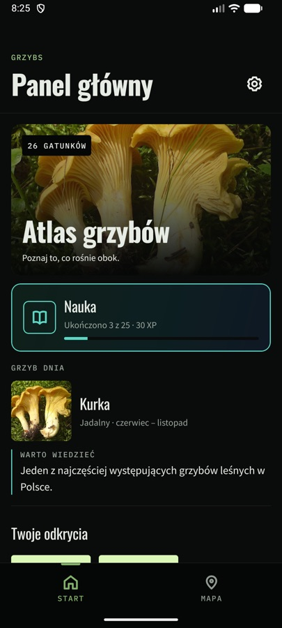
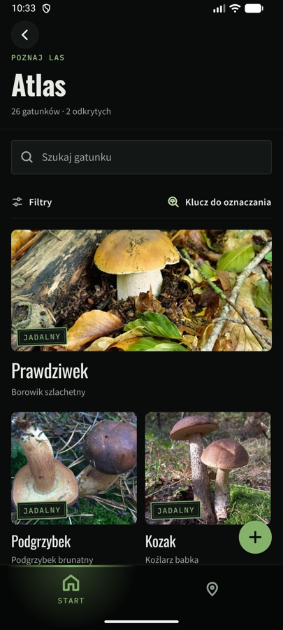
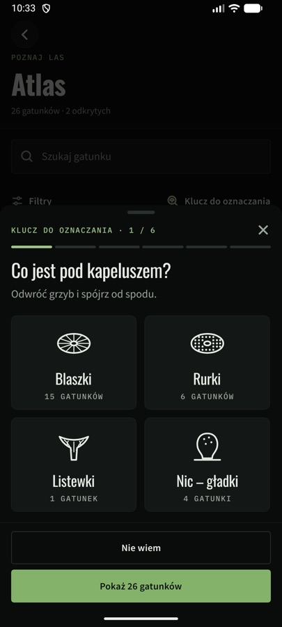
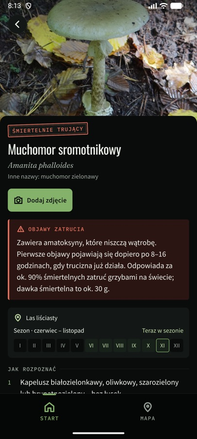
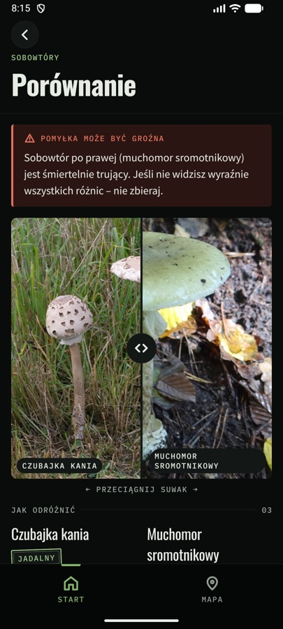
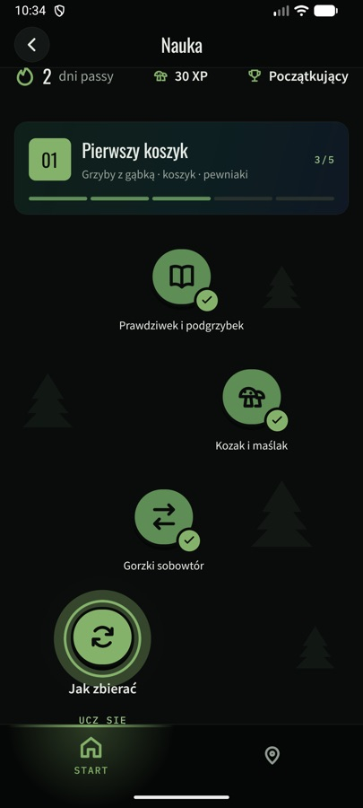
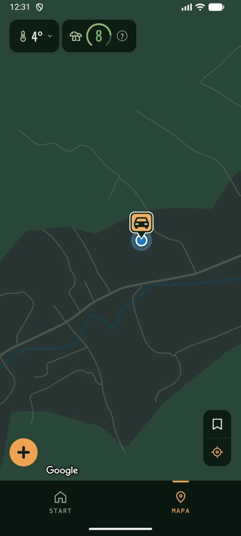
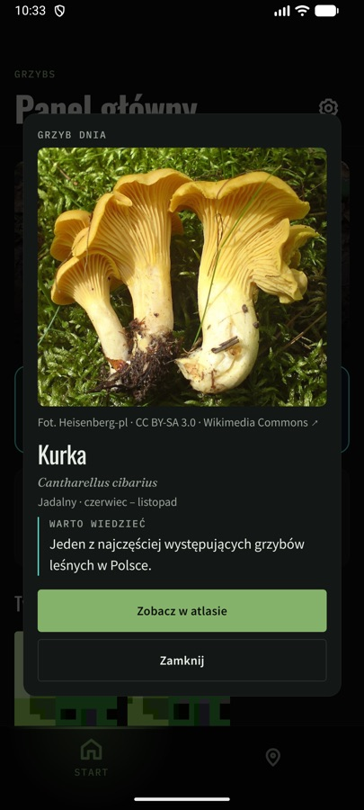

# Grzybs 🍄

Kieszonkowy przewodnik grzybiarza: atlas 26 polskich gatunków z ostrzeżeniami przed trującymi sobowtórami, nauka rozpoznawania krok po kroku, własny rejestr znalezisk ze zdjęciami oraz mapa z miejscówkami, pogodą i powrotem do auta. Wszystko poza kafelkami mapy i prognozą pogody działa offline – w lesie zasięg bywa słaby.

> Zadanie rekrutacyjne Software Mansion. React Native + Expo (SDK 58), TypeScript. Autor: [perarz](https://github.com/perarz).

<p>
  
  
  
  
</p>
<p>
  
  
  
  
</p>
<p>
  
</p>

## Platforma i testy

- **Przygotowana głównie pod:** Android.
- **Testowana na fizycznym urządzeniu:** tak – telefon z Androidem, przez Expo Go.
- **Emulator:** Android Studio, Medium Phone (API 37), Expo Go 58.0.5 – wszystkie ekrany przeklikane 2026-11-21, w tym zdjęcie z aparatu, zapis znaleziska, mapa i lekcje; zmiany z 2026-11-22 sprawdzone na emulatorze; zrzuty poniżej pochodzą z 2026-11-22.
- **iOS:** nie był testowany.

## Uruchomienie

Wymagania: Node.js (wersja w `.nvmrc`), npm i [Expo Go](https://expo.dev/go) w wersji dla SDK 58.

```bash
npm install
npx expo start
```

- **Emulator Androida:** w terminalu z `npx expo start` naciśnij `a`.
- **Telefon:** zeskanuj kod QR z terminala aplikacją Expo Go.

Aplikacja działa w Expo Go bez własnego buildu. Jedyna funkcja, której Expo Go nie obsługuje, to alerty pogodowe w tle (wymagają development buildu) – aplikacja mówi o tym przy próbie włączenia.

### Płynność

Zwykłe `npx expo start` uruchamia tryb deweloperski, w którym JavaScript działa kilka razy wolniej, a animacje mogą przycinać. Żeby zobaczyć płynność taką jak w gotowej aplikacji, uruchom tryb produkcyjny – nadal w Expo Go:

```bash
npx expo start --no-dev --minify
```

### Własny plik APK (opcjonalnie)

Do oceny wystarczy Expo Go. Samodzielny APK buduje się w chmurze przez [EAS Build](https://docs.expo.dev/build/introduction/) (profil `preview` w `eas.json`):

```bash
npx eas-cli@latest login
npx eas-cli@latest env:set --name GOOGLE_MAPS_API_KEY --value <klucz> --environment preview --visibility sensitive
npx eas-cli@latest build -p android --profile preview
```

Mapa Google na Androidzie poza Expo Go wymaga klucza „Maps SDK for Android” z Google Cloud. Klucz nie trafia do repozytorium – `app.config.ts` czyta go ze zmiennej EAS. Build bez klucza też działa: zamiast mapy pokazuje komunikat, a miejsca, kompas i powrót do auta działają dalej.

## Funkcje

**Start** – wejście do atlasu i nauki (karta z gradientem, postępem i XP), „grzyb dnia” schowany za znakiem zapytania – dotknięcie otwiera okno z gatunkiem, zdjęciem i jedną rzeczą „warto wiedzieć” z atlasu, oraz ostatnie własne znaleziska. Przycisk zdjęcia od razu otwiera aparat.

**Atlas** – 26 gatunków podzielonych na jadalne, niejadalne, trujące i śmiertelnie trujące; zdjęcia na wolnych licencjach, wyszukiwarka bez polskich znaków („kozlarz” znajdzie koźlarza), filtry „Rośnie teraz” i „Moje odkrycia”.

**Klucz do oznaczania** – zamiast ściany filtrów pytania po kolei: co jest pod kapeluszem, kolor, pierścień, pochwa, zmiana barwy miąższu, siedlisko. Każda odpowiedź ma ilustrację SVG i liczbę gatunków, które zostaną; odpowiedzi prowadzące donikąd są wyszarzone.

**Karta gatunku** – opis, cechy rozpoznawcze, kalendarz sezonu, objawy zatrucia i alert o groźnych sobowtórach. Porównanie z sobowtórem pokazuje oba zdjęcia pod przeciąganym suwakiem i tabelę różnic; śmiertelnie trujący sobowtór jest oznaczony kolorem i haptyką.

**Rejestr znalezisk** – jedno dotknięcie na Starcie lub na karcie gatunku otwiera aparat (galeria jest dostępna z ekranu kolekcji) → wybór gatunku z listy z miniaturami z atlasu → sprawdzenie: Twoje zdjęcie obok zdjęcia wzorcowego, a przy groźnym sobowtórze krótkie ostrzeżenie i cechy odróżniające → zapis. Opcjonalnie waga, miejsce z GPS (jednym dotknięciem; znalezisko pojawia się wtedy na mapie jako pinezka ze zdjęciem) i opis; wszystko można później edytować na karcie gatunku. Zdjęcie jest dowodem znaleziska, nie jest rozpoznawane automatycznie, a zapis nie potwierdza jadalności. Zdjęcia zostają w pamięci telefonu i można je usunąć.

**Nauka** – 5 etapów po 4 lekcje i test etapu na końcu (ostatni to egzamin z całości). Lekcja ma około 7 kart: nowy gatunek albo zasada grzybiarza (np. koszyk zamiast reklamówki, wykręcanie zamiast odcinania, co robić przy podejrzeniu zatrucia), potem różne typy pytań – zdjęcie → nazwa, nazwa → zdjęcie, „do koszyka czy zostawiam”, para sobowtórów, sytuacje z lasu. Pytania dotyczą tylko tego, co już było. Bez „żyć”: błędna odpowiedź pokazuje wyjaśnienie i wraca na końcu lekcji. Pasek postępu, seria poprawnych odpowiedzi, XP, rangi, dzienna passa (dotknięcie licznika pokazuje kalendarz dni z nauką), okno „za co XP” z sześcioma rangami – po jednej za etap, dźwięki (do wyłączenia w ustawieniach) i haptyka. Ścieżka pokazuje wszystkie etapy: ukończone lekcje na zielono, bieżąca pulsuje, dalsze etapy są przygaszone, a każdy etap ma własne leśne tło. Przerwanie lekcji potwierdza się we własnym oknie aplikacji.

**Ustawienia** – dźwięki i wibracje, powiadomienia o korzystnych warunkach (tylko w buildzie, nie w Expo Go), powitanie od nowa, kurs od nowa i usunięcie wszystkich znalezisk (z potwierdzeniem) oraz źródła i licencje.

**Nawigacja** – dwie zakładki: Start i Mapa; przesunięcie palcem w lewo na Starcie otwiera Mapę (na Mapie gest zostaje dla przesuwania mapy).

**Mapa** – prywatne miejscówki (z GPS albo przytrzymaniem mapy) z notatkami, zapis miejsca parkowania i powrót do auta: odległość i kierunek z kompasem, ostrzeżenie przed zachodem słońca. Panel zapisanych miejsc ma przycisk „+” do dodania miejscówki, a auto i miejscówki usuwa się po potwierdzeniu we własnym oknie. Prognoza na 3 dni (Open-Meteo) z pamięcią offline i orientacyjny „indeks grzybowy” 1–10 liczony z opadów i temperatur ostatniego tygodnia.

## Decyzje techniczne

- **Offline-first:** dane użytkownika w SQLite (`expo-sqlite`) z wersjonowanymi migracjami (`PRAGMA user_version`); atlas, zdjęcia gatunków i fonty są w paczce aplikacji.
- **Odporność na błędy:** GPS, aparat, sieć, baza i uprawnienia mają obsługę błędów i stany zastępcze; globalny `ErrorBoundary` zamiast crasha.
- **Start w Expo Go:** Expo Go 58 na Androidzie daje moduły natywne nowego typu (m.in. SQLite) tylko pierwszemu silnikowi JS w procesie – gdy Expo Go ma już otwarty inny projekt, zwykły start kończy się błędem `Cannot find native module 'ExpoSQLite'`. Wejście `index.ts` sprawdza moduły, zanim wczyta router i bazę, i w razie potrzeby raz przeładowuje własny silnik JS. Opis: [docs/expo-startup-investigation.md](docs/expo-startup-investigation.md).
- **Ruch i dotyk:** Reanimated 4 (sprężyny, layout animations, CSS transitions) i Gesture Handler 3; każdy przycisk reaguje sprężyną i haptyką (`expo-haptics`).
- **Dane o grzybach:** pisane własnymi słowami na podstawie źródeł poniżej i sprawdzane z nimi; niepewny fakt oznaczamy w kodzie `TODO: verify` (obecnie żadnego takiego nie ma – ostatni, sezon krowiaka, potwierdzono 2026-11-22).
- **Okna i panele:** wybory krok po kroku w panelu od dołu, który ma wysokość swojej treści; pytania przed nieodwracalną akcją we wspólnym `ConfirmDialog` zamiast systemowego `Alert`.
- **Wygląd „Nocny las”:** tło prawie czarne, przyciski w zieleni mchu, aqua dla nauki, pomarańcz kurki tylko przy ostrzeżeniach; Oswald + Source Sans Pro, łacina kursywą Fraunces, etykiety IBM Plex Mono.

## Stack

Expo SDK 58 · React Native 0.88 · TypeScript (strict) · expo-router · Reanimated 4 · Gesture Handler 3 · react-native-svg · react-native-maps · expo-location · expo-image-picker · expo-file-system · expo-sqlite · expo-haptics · expo-audio · suncalc

## Struktura

```
index.ts          wejście: sprawdzenie modułów natywnych, potem expo-router
src/app/          ekrany (expo-router): (tabs)/(home) – Start, Atlas, Nauka, kolekcja, ustawienia; (tabs)/map
src/components/   komponenty UI pogrupowane według funkcji
src/features/     logika bez UI: atlas, collection, learn, spots, navigation, weather, safety, startup
src/db/           SQLite: połączenie i migracje
src/data/         statyczne dane: gatunki, sobowtóry, zdjęcia, źródła
src/theme/        kolory, typografia, odstępy, ruch
tests/            testy jednostkowe (node:test, SQLite w pamięci przez node:sqlite)
```

## Skrypty

| Komenda             | Co robi                                                     |
| ------------------- | ----------------------------------------------------------- |
| `npx expo start`    | serwer deweloperski (`a` – emulator Androida, QR – Expo Go) |
| `npm run lint`      | ESLint + Prettier                                           |
| `npm run typecheck` | TypeScript (`tsc --noEmit`)                                 |
| `npm test`          | testy logiki, danych, migracji SQLite i scenariuszy błędów  |

CI (GitHub Actions) uruchamia lint, typecheck i testy przy każdym pushu.

## Znane ograniczenia

- Kafelki mapy i prognoza pogody wymagają internetu; reszta działa offline.
- Powrót do auta pokazuje kierunek w linii prostej, nie trasę pieszą.
- Alerty o dobrych warunkach w tle działają tylko w development/release buildzie, nie w Expo Go.
- Jeśli przy pytaniu o aparat wybierzesz „Tylko tym razem” i aparat zostanie otwarty dłużej niż minutę, Android może zamknąć Expo Go i zdjęcie przepada – przy „Podczas używania aplikacji” problem nie występuje.
- Indeks grzybowy to heurystyka aplikacji, nie prognoza wysypu.
- Miejsce znaleziska to pozycja telefonu w chwili dotknięcia „Dodaj miejsce” (GPS, bez trybu dokładności Google); lokalizacja zapisana w samym zdjęciu nie jest odczytywana.

## Źródła i licencje

**Wiedza o gatunkach** (jadalność, toksyczność, sezony, siedliska, sobowtóry) – opracowana własnymi słowami na podstawie:

- artykułów o poszczególnych gatunkach w [polskiej Wikipedii](https://pl.wikipedia.org),
- [Medycyna Praktyczna – zatrucie piestrzenicą kasztanowatą](https://www.mp.pl/pacjent/pierwsza_pomoc/441487,zatrucie-piestrzenica-kasztanowata),
- poradnika Lasów Państwowych [„Bezpieczne grzybobranie”](https://www.lasy.gov.pl/pl/informacje/aktualnosci/wystawa-o-grzybach-juz-otwarta/BEZPIECZNE-GRZYBOBRANIE.pdf/@@download/file/BEZPIECZNE-GRZYBOBRANIE.pdf),
- kalendarzy grzybiarza stacji sanitarno-epidemiologicznych ([gov.pl](https://www.gov.pl/web/psse-wabrzezno/w-lesie-grzybow-coraz-wiecej)).
- zasady grzybiarza w lekcjach: Główny Inspektorat Sanitarny – [„Bezpieczne grzybobranie”](https://www.gov.pl/web/gis/bezpieczne-grzybobranie) i [poradnik dla miłośników zbierania grzybów](https://www.gov.pl/web/gis/dla-milosnikow-zbierania-grzybow2); Lasy Państwowe – [zakazy wstępu do lasu](https://www.lasy.gov.pl/pl/informacje/zakazy-wstepu-do-lasow).

Niepewne fakty oznaczamy w kodzie jako `TODO: verify`; obecnie w danych nie ma takich oznaczeń.

**Zdjęcia gatunków** pochodzą z [Wikimedia Commons](https://commons.wikimedia.org), są na licencjach Creative Commons i zostały zmniejszone do 800 px. Kliknij nazwę gatunku, aby zobaczyć oryginał.

| Gatunek                                                                                                               | Autor                               | Licencja        |
| --------------------------------------------------------------------------------------------------------------------- | ----------------------------------- | --------------- |
| [Borowik szlachetny](https://commons.wikimedia.org/wiki/File:Boletus_edulis_IT.jpg)                                   | ReddishClover                       | CC BY-SA 4.0    |
| [Podgrzybek brunatny](https://commons.wikimedia.org/wiki/File:Boletus_badius_G1.jpg)                                  | Jerzy Opioła                        | CC BY-SA 4.0    |
| [Koźlarz babka](https://commons.wikimedia.org/wiki/File:Leccinum_scabrum_G3.1.jpg)                                    | Jerzy Opioła                        | CC BY-SA 4.0    |
| [Koźlarz czerwony](https://commons.wikimedia.org/wiki/File:Leccinum_aurantiacum_G4.JPG)                               | Jerzy Opioła                        | CC BY-SA 3.0    |
| [Maślak zwyczajny](https://commons.wikimedia.org/wiki/File:Suillus_luteus_2.jpg)                                      | Jerzy Opioła                        | CC BY-SA 3.0    |
| [Pieprznik jadalny](https://commons.wikimedia.org/wiki/File:Cantharellus_cibarius_20090717-02.jpg)                    | Heisenberg-pl                       | CC BY-SA 3.0    |
| [Czubajka kania](https://commons.wikimedia.org/wiki/File:Macrolepiota-procera.jpg)                                    | Chrumps                             | CC BY-SA 4.0    |
| [Gołąbek zielonawy](https://commons.wikimedia.org/wiki/File:Russula_virescens_B%C5%BB2.1.jpg)                         | Jerzy Opioła                        | CC BY-SA 3.0    |
| [Pieczarka polna](https://commons.wikimedia.org/wiki/File:2012-02-13_Agaricus_campestris_L_199588.jpg)                | Byrain (Mushroom Observer)          | CC BY-SA 3.0    |
| [Opieńka miodowa](<https://commons.wikimedia.org/wiki/File:Armillaria_mellea_PN1_(5).jpg>)                            | Jerzy Opioła                        | CC BY-SA 4.0    |
| [Mleczaj rydz](https://commons.wikimedia.org/wiki/File:Lactarius_deliciosus.jpg)                                      | Eric Steinert                       | CC BY-SA 3.0    |
| [Smardz jadalny](https://commons.wikimedia.org/wiki/File:2011-04-30_Morchella_esculenta.jpg)                          | Andreas Kunze                       | CC BY-SA 3.0    |
| [Purchawka chropowata](https://commons.wikimedia.org/wiki/File:Lycoperdon_perlatum_a3.jpg)                            | Jerzy Opioła                        | CC BY-SA 4.0    |
| [Goryczak żółciowy](https://commons.wikimedia.org/wiki/File:Tylopilus_felleus_060914c.jpg)                            | bernd gliwa                         | CC BY-SA 2.5    |
| [Lisówka pomarańczowa](https://commons.wikimedia.org/wiki/File:Hygrophoropsis_aurantiaca_B%C5%BB5.2.jpg)              | Jerzy Opioła                        | CC BY-SA 3.0    |
| [Muchomor czerwony](https://commons.wikimedia.org/wiki/File:Amanita_muscaria_3_vliegenzwammen_op_rij.jpg)             | Onderwijsgek                        | CC BY-SA 3.0 nl |
| [Muchomor plamisty](https://commons.wikimedia.org/wiki/File:Amanita_pantherina_ts4.jpg)                               | Tomasz Sobczak                      | CC BY-SA 4.0    |
| [Maślanka wiązkowa](https://commons.wikimedia.org/wiki/File:Hypholoma_fasciculare_LC0091.jpg)                         | Jörg Hempel                         | CC BY-SA 2.0 de |
| [Mleczaj wełnianka](https://commons.wikimedia.org/wiki/File:Lactarius_torminosus_G2.jpg)                              | Jerzy Opioła                        | CC BY-SA 3.0    |
| [Tęgoskór pospolity](<https://commons.wikimedia.org/wiki/File:Earthballs_(908565114).jpg>)                            | Jason Hollinger                     | CC BY 2.0       |
| [Pieczarka karbolowa](https://commons.wikimedia.org/wiki/File:2010-11-13_Agaricus_xanthodermus_Genev_120348_crop.jpg) | Lord Mayonnaise (Mushroom Observer) | CC BY-SA 3.0    |
| [Krowiak podwinięty](https://commons.wikimedia.org/wiki/File:Paxillus_involutus_G2.jpg)                               | Selso                               | CC BY-SA 3.0    |
| [Muchomor sromotnikowy](<https://commons.wikimedia.org/wiki/File:Amanita_phalloides_a1_(1).JPG>)                      | Jerzy Opioła                        | CC BY-SA 4.0    |
| [Muchomor jadowity](<https://commons.wikimedia.org/wiki/File:Amanita_virosa_a1_(7).JPG>)                              | Jerzy Opioła                        | CC BY-SA 4.0    |
| [Hełmówka jadowita](https://commons.wikimedia.org/wiki/File:Galerina_marginata_61108.jpg)                             | Dan Molter (Mushroom Observer)      | CC BY-SA 3.0    |
| [Piestrzenica kasztanowata](https://commons.wikimedia.org/wiki/File:Gyromitra_esculenta_BPN1.jpg)                     | Jerzy Opioła                        | CC BY-SA 4.0    |

**Fonty** (licencja [SIL Open Font License 1.1](https://openfontlicense.org), pliki licencji w `assets/fonts/`):

- [Oswald](https://github.com/googlefonts/OswaldFont) – The Oswald Project Authors,
- [Source Sans Pro](https://github.com/adobe-fonts/source-sans) – Adobe,
- [Fraunces](https://github.com/undercasetype/Fraunces) – The Fraunces Project Authors,
- [IBM Plex Mono](https://github.com/IBM/plex) – IBM Corp.

Dźwięki lekcji (`assets/sounds/`) są własne – generuje je skrypt `scripts/generate-sounds.py` z czystych tonów. Ikona aplikacji też jest własna – rysuje ją `scripts/make-icon.py` (SVG), a `scripts/render-svg.js` zamienia na PNG.

Prognoza pogody: [Open-Meteo](https://open-meteo.com/), dane na licencji [CC BY 4.0](https://creativecommons.org/licenses/by/4.0/); bezpłatne API do zastosowań niekomercyjnych.

## Zastrzeżenie

Aplikacja ma charakter edukacyjny i **nie zastępuje konsultacji z grzyboznawcą**. Nigdy nie jedz grzyba, którego nie jesteś w 100% pewien.
